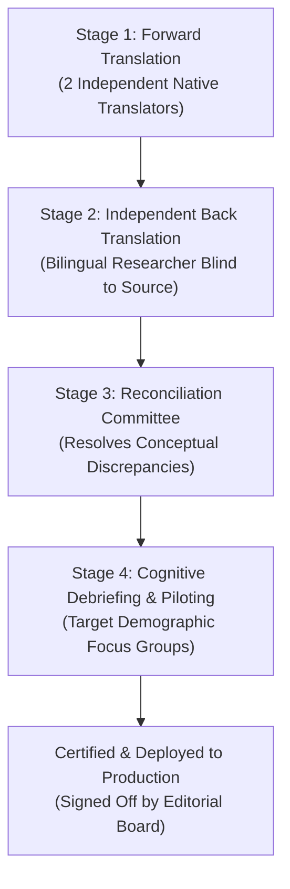

# Tinat Multilingual Translation Protocol & Governance

This document establishes the official scientific translation methodology for the Tinat research platform, adhering to World Health Organization (WHO) and Cross-Cultural Survey Guidelines (CCSG).

---

## 1. Ethical Mandate & Quality Invariant

Machine translation algorithms cannot guarantee semantic fidelity, cultural appropriateness, or ethical nuance for sensitive health, economic, and demographic surveys across Ethiopia.

### The Platform Rule:
1. **Zero Unreviewed Machine Translations in Production:** No machine-translated text may ever be displayed to survey participants as authoritative.
2. **Status Registry (`messages/status.json`):** Every locale dictionary starts with `"status": "NEEDS_HUMAN_REVIEW"` and `"shippedInProduction": false`.
3. **Reconciliation Gate:** Only strings that have successfully traversed the 4-stage translation pipeline below and received certification by an accredited linguist may be flipped to `"status": "REVIEWED"`.

---

## 2. Four-Stage Translation Protocol

### Stage 1: Forward Translation
- Two independent, accredited translators whose primary native language is the target language (e.g., Amharic, Afaan Oromo, Tigrinya, Somali) translate the source English strings.
- Translators must have formal training in health research or social sciences.
- Focus is on **conceptual equivalence** rather than literal word-for-word translation.

### Stage 2: Blind Back-Translation
- An independent bilingual linguist who has **never seen the original English source** translates the target language version back into English.
- This objective back-translation serves as an error-detection filter to unearth misinterpretations, ambiguities, or unintended shifts in meaning.

### Stage 3: Reconciliation Committee
- A multidisciplinary panel consisting of:
  - Lead Study Researcher / Principal Investigator
  - Forward Translators
  - Back Translator
  - Community Cultural Consultant
- The committee reviews differences between the source and back-translated English. Discrepancies are discussed until consensus is reached on the final harmonized target text.

### Stage 4: Cognitive Debriefing and Pre-Testing
- The reconciled questionnaire is pre-tested with a representative sample of 10–15 respondents from the target population (e.g., in Addis Ababa, Hawassa, Adama, Mekelle, and Jigjiga).
- "Think-aloud" protocols and cognitive interviews are conducted:
  - Did the respondent understand the question as intended?
  - Were any terms offensive, awkward, or confusing?
  - Did the response scale make sense in local cultural context?
- Revisions are submitted to the committee for final approval.

---

## 3. Supported Languages & Target Coverage

| Locale Code | Language Name | Script | Coverage / Dialect Standard | Font Enforced |
| :--- | :--- | :--- | :--- | :--- |
| `en` | English | Latin | International Scientific Standard | Inter |
| `am` | Amharic (አማርኛ) | Ge'ez (ፊደል) | Standard Ethiopian Federal Working Language | Noto Sans Ethiopic |
| `om` | Afaan Oromo | Qubee (Latin) | Standard Oromia Regional Working Language | Inter |
| `ti` | Tigrinya (ትግርኛ) | Ge'ez (ፊደል) | Standard Tigray Regional Working Language | Noto Sans Ethiopic |
| `so` | Somali (Af-Soomaali) | Latin | Standard Somali Regional Working Language | Inter |

---

## 4. Ethiopic Typography Standards (Ge'ez Script)

All user interfaces, data exports (Excel, CSV), and generated social deck cards must properly render Ge'ez ligatures, diacritics, and Ethiopic punctuation:
- **Primary Font:** `Noto Sans Ethiopic` loaded via `@next/font/google` with CSS variable `--font-ethiopic`.
- **Fallbacks:** System Ethiopic (`Nyala`, `Abyssinica SIL`, `Kefa`).
- **Punctuation:** Native Ethiopic word separators (`፡`), full stops (`።`), commas (`፣`), and semicolons (`፤`) must not be replaced with ASCII equivalents in Amharic and Tigrinya locales.

---

## 5. Translator and Reviewer Registry

The table below maintains the official record of qualified human translators and reviewers responsible for certifying locale dictionaries.

| Locale | Name / Institution | Accreditation / Qualifications | Role | Certification Status |
| :--- | :--- | :--- | :--- | :--- |
| `en` | Tinat Editorial Board | Addis Ababa University Academic Review Panel | Source Reviewer | **CERTIFIED (REVIEWED)** |
| `am` | Pending Accreditation Committee | Institute of Ethiopian Studies (IES), AAU | Forward & Back Translation | *NEEDS_HUMAN_REVIEW* |
| `om` | Pending Accreditation Committee | Oromo Language Academy, Jimma University | Forward & Back Translation | *NEEDS_HUMAN_REVIEW* |
| `ti` | Pending Accreditation Committee | Mekelle University Linguistics Department | Forward & Back Translation | *NEEDS_HUMAN_REVIEW* |
| `so` | Pending Accreditation Committee | Jigjiga University Somali Studies Center | Forward & Back Translation | *NEEDS_HUMAN_REVIEW* |

---

## 6. Audit Trail & Git Invariants

1. Changes to `messages/*.json` must be committed alongside an update to `messages/status.json`.
2. Any pull request flipping a locale from `NEEDS_HUMAN_REVIEW` to `REVIEWED` must attach:
   - The reconciliation committee meeting minutes.
   - The cognitive debriefing summary report.
   - Translator names and accreditation credentials.
